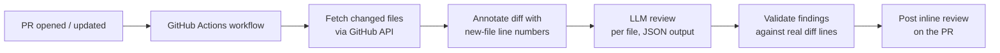

# AI Code Review Bot

[](https://github.com/Ruzen05/ai-code-review-bot/actions/workflows/tests.yml)


A bot that runs in your CI pipeline, reads the diff of every Pull Request, and posts inline review comments on potential bugs, security issues and unhandled edge cases. No server to host: it runs as a GitHub Actions job.

## How it works



1. The workflow triggers on `pull_request` (opened, synchronize, reopened).
2. `review_bot.py` lists the PR's changed files and skips lockfiles, images and minified assets.
3. Each diff line is prefixed with its line number in the new version of the file, so the model can point at exact lines.
4. The model is prompted to report **real problems only** (bugs, logic errors, security issues, resource leaks, missing error handling) and to ignore style nitpicks. It replies in JSON.
5. Findings that reference a line not present in the diff are discarded, so hallucinated line numbers never reach GitHub.
6. Everything is posted as a single review with inline comments. If GitHub rejects an inline position, the bot falls back to one summary comment.

## Quick start

1. Copy these into your repository, keeping the paths:
   - `review_bot.py`
   - `requirements.txt`
   - `.github/workflows/ai-review.yml`
2. Add a repository secret named `ANTHROPIC_API_KEY` (Settings → Secrets and variables → Actions).
3. Open a pull request. The bot comments within a minute or so.

`GITHUB_TOKEN` is provided automatically by Actions. The workflow only needs `contents: read` and `pull-requests: write`.

### Configuration

| Variable | Default | Purpose |
| --- | --- | --- |
| `REVIEW_MODEL` | `claude-sonnet-5-5` | Model used for reviews |

Cost and noise limits live as constants at the top of `review_bot.py`: `MAX_FILES`, `MAX_PATCH_CHARS`, `MAX_FINDINGS_PER_FILE`, `SKIP_SUFFIXES`.

## Run the tests

```bash
pip install -r requirements.txt -r requirements-dev.txt
pytest
```

The tests cover the diff parser and model-output parsing and run offline, with no API key needed.

## Design decisions

- **Actions over webhooks.** Actions needs no hosting and gets a scoped token for free. A webhook service would be the next step for multi-repo or org-wide use.
- **Fork PRs are skipped.** GitHub withholds secrets from forked PRs, and running untrusted code next to an API key is unsafe.
- **The diff is treated as untrusted input.** The system prompt tells the model to ignore instructions found inside the diff, which mitigates prompt injection via code comments.
- **Validate model output.** The model's JSON is parsed defensively and every line number is checked against the diff before posting.
- **Cost guards.** Capped files per PR, capped diff size per file, capped findings per file.

## Limitations

- Reviews each file independently, so cross-file issues (a changed function signature and its callers) are missed.
- Every push to a PR adds a new review rather than updating the previous one.
- The model sees the diff only, not the full file or repository context.
- LLM reviews can be wrong. Treat the comments as suggestions, not a gate.

## Roadmap

- [ ] Update or hide the bot's earlier comments on new pushes
- [ ] Per-repo config file (ignored paths, severity threshold)
- [ ] Send surrounding file context along with the diff
- [ ] Evaluation set of PRs with known bugs to measure precision and recall
- [ ] Package as a reusable GitHub Action
- [ ] Optional OpenAI backend

## License

MIT. See [LICENSE](LICENSE).
